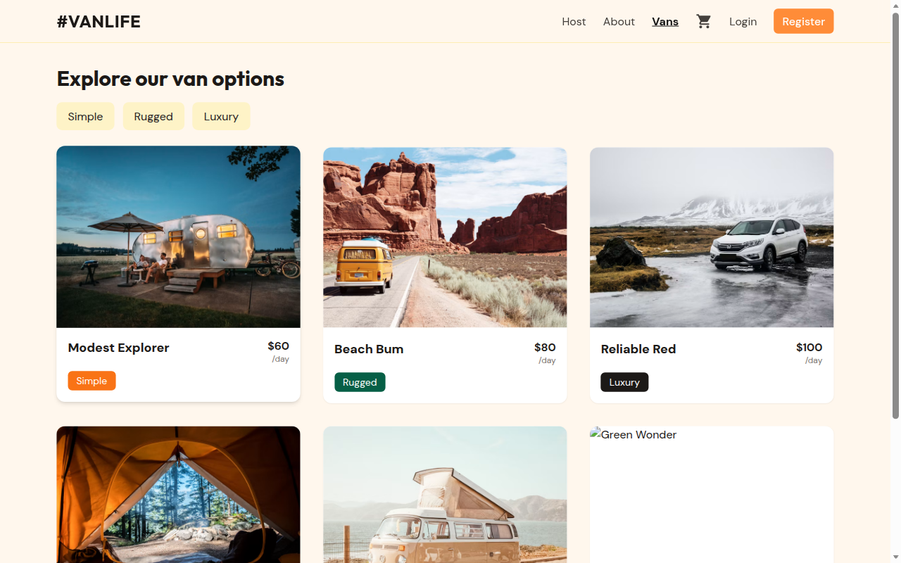
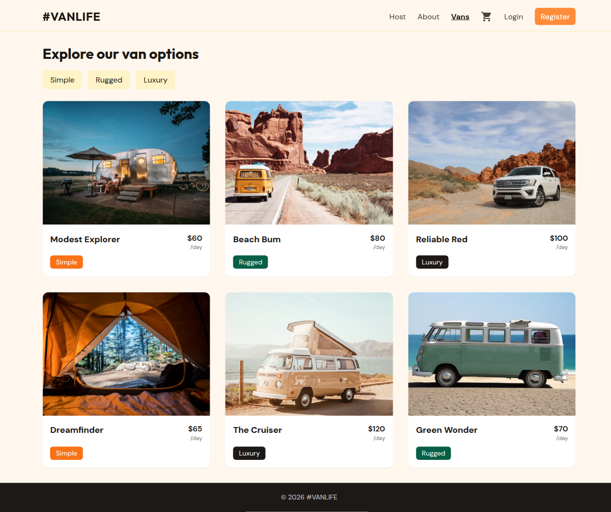
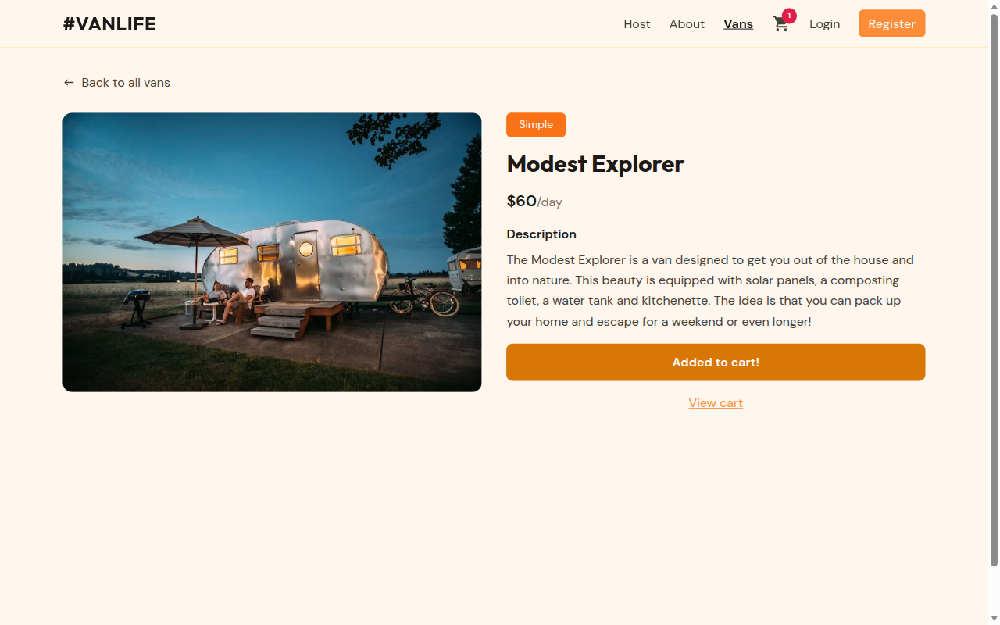
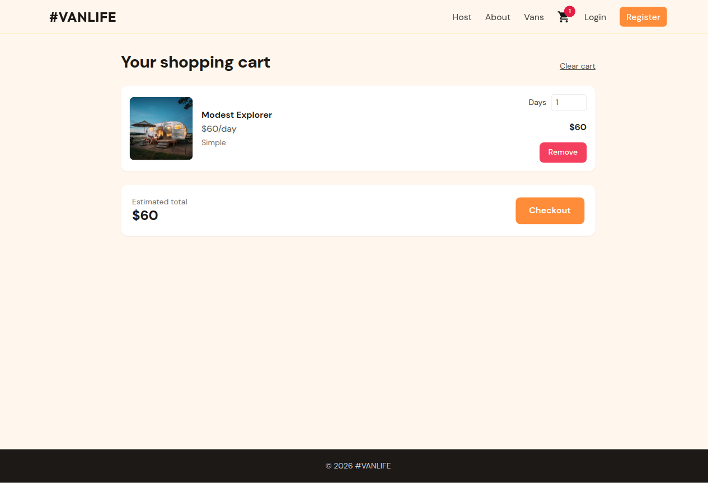
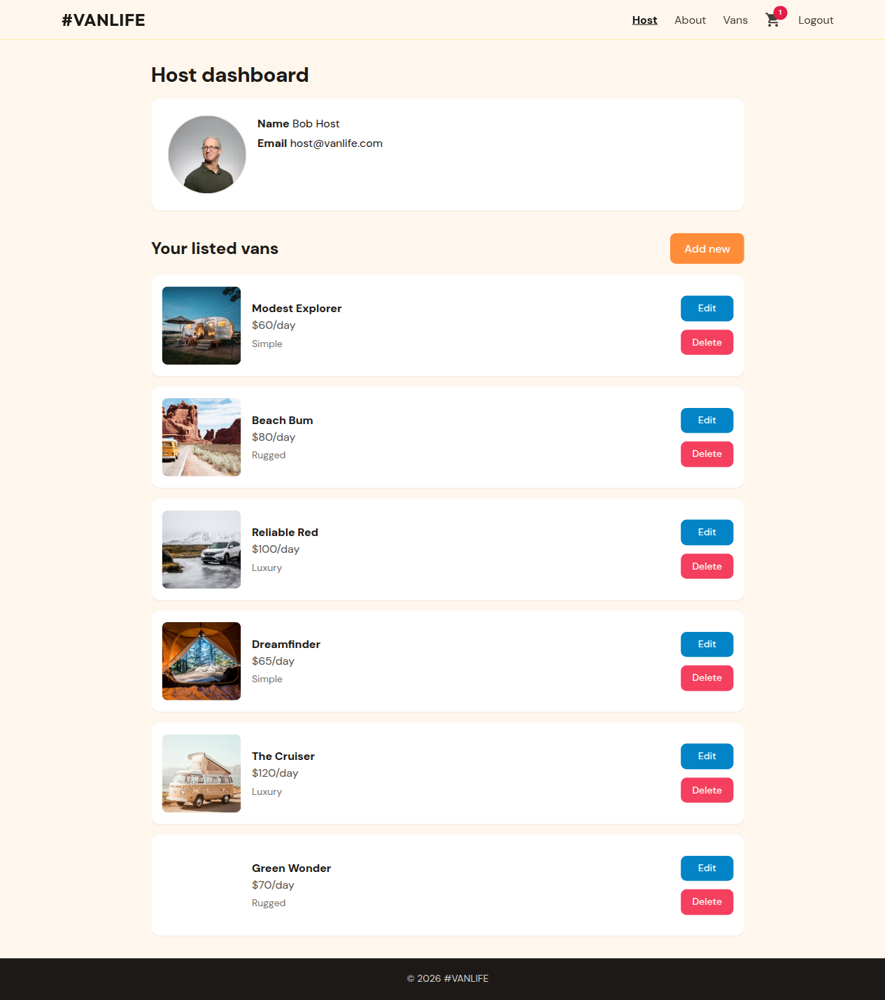

# #VanLife

A polished React van-rental demo for portfolio use. Browse the fleet, filter by type, rent vans into a cart, and manage host listings with auth-gated CRUD — all running client-side with a seeded mock API (no backend required).



## Features

- **Browse vans** with type filters (simple / rugged / luxury)
- **Van detail** pages with rent-to-cart
- **Shopping cart** with day counts, totals, and checkout (demo)
- **Auth** — register, login, logout (localStorage session)
- **Host dashboard** — profile, list / add / edit / delete vans, detail tabs
- **Empty, loading, and error** states throughout
- **Responsive** layout (mobile nav + desktop)

## Tech stack

- React 18 + Create React App
- React Router 6 (data routers, loaders, deferred data)
- Redux Toolkit + redux-persist (cart)
- Formik + Yup (forms)
- Tailwind CSS
- Client-side mock API (`src/api`) with localStorage persistence

## Screenshots

| Home | Vans |
| --- | --- |
|  |  |

| Van detail | Cart |
| --- | --- |
|  |  |

| Host dashboard | Mobile |
| --- | --- |
|  |  |

## Getting started

```bash
npm install
npm start
```

Open [http://localhost:3000](http://localhost:3000).

### Demo host login

| Field | Value |
| --- | --- |
| Email | `host@vanlife.com` |
| Password | `password123` |

### Scripts

| Command | Description |
| --- | --- |
| `npm start` | Dev server |
| `npm run build` | Production build |
| `npm test` | Jest tests |
| `npm run lint` | ESLint |
| `npm run format` | Prettier write |
| `npm run format:check` | Prettier check |

## Environment variables

Copy `.env.example` if you want local overrides. The app uses a **client-side mock API**, so no `REACT_APP_API_URL` is required.

Optional:

```bash
# Artificial mock API delay in ms (if you wire REACT_APP_API_DELAY into the mock)
# REACT_APP_API_DELAY=350
```

## Project structure

```
src/
  api/           # Mock store, seed data, API helpers + tests
  components/    # Layout, header, forms, loader, error
  contexts/      # Auth context
  features/      # Redux cart slice
  pages/         # Home, vans, cart, auth, host CRUD
```

## Notes

- Seeded vans and the demo host live in `localStorage`. Bumping `SEED_VERSION` in `src/api/seedData.js` refreshes seed data for visitors.
- Host routes are protected via React Router loaders (`requireAuth`).
- CI (GitHub Actions) runs lint, format check, build, and tests on `main` and PRs.
